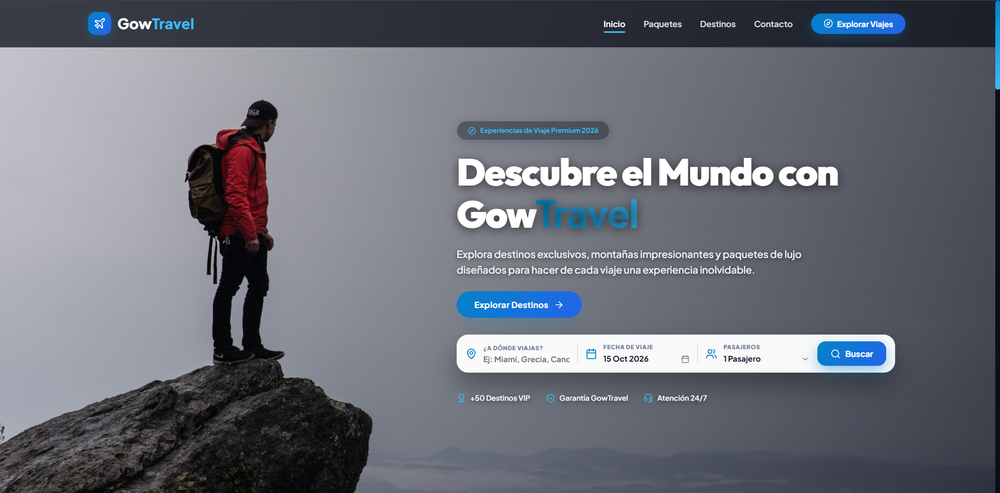
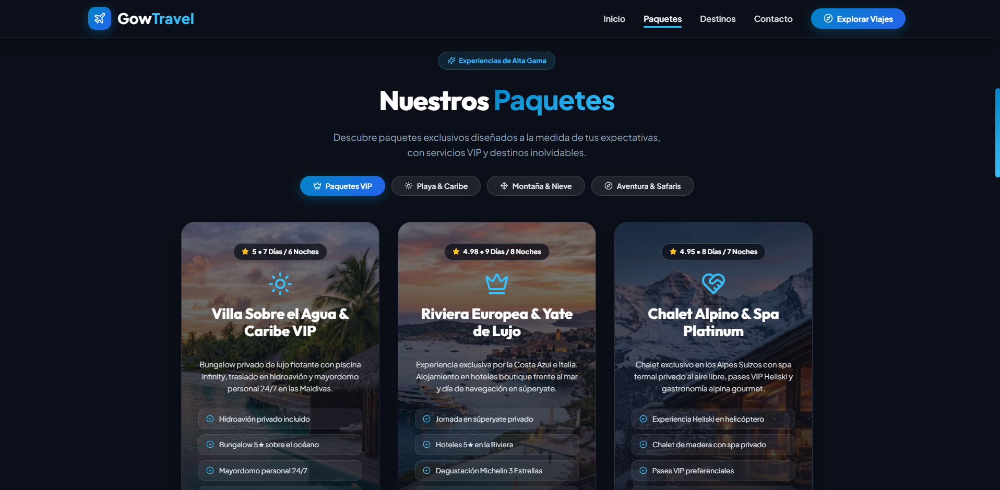
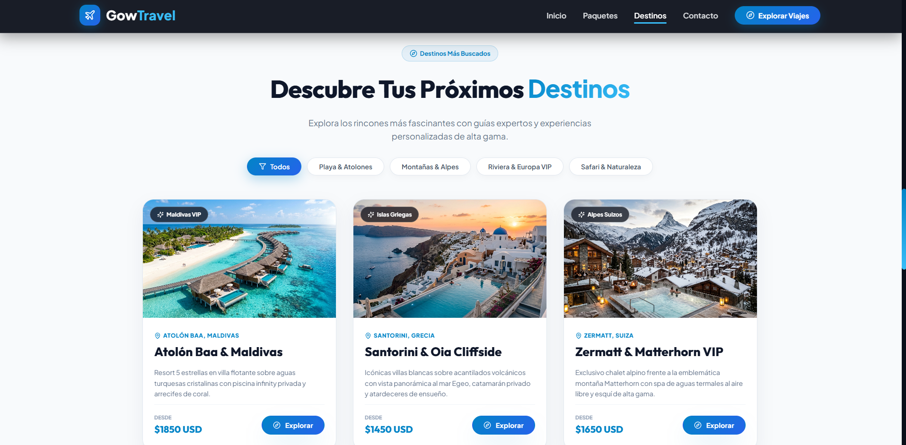
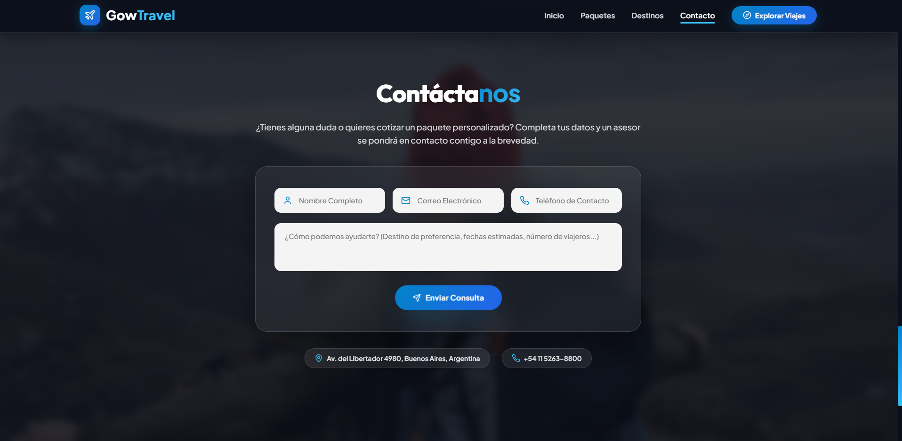

<div align="center">

  <h1>✈️ GowTravel — Agencia de Viajes & Experiencias VIP</h1>

  <p>
    Plataforma web prémium e interactiva de turismo y viajes de lujo, desarrollada con diseño moderno glassmorphic, animaciones fluidas GSAP y experiencia de usuario de alta gama.
  </p>

  <p>
    <a href="https://waveframe.com.ar/" target="_blank">
      
    </a>
    
    
    
    
  </p>

</div>

---

## 📸 Galería de la Plataforma

<p align="center">
  
  
</p>
<p align="center">
  
  
</p>

---

## ✨ Características Principales

- 🌟 **Experiencias VIP & Alta Gama:** Selección exclusiva de paquetes turísticos de lujo en playas paradisíacas, alpes suizos, rivieras europeas y safaris africanos.
- 🗓️ **Buscador con Calendario & Pasajeros Personalizado:** Widgets interactivos de alta definición para selección de fechas y configuración de viajeros.
- 🎬 **Animaciones Fluidas GSAP & ScrollTrigger:** Revelados sedosos y efectos cinemáticos al hacer scroll por cada sección del sitio.
- 🏔️ **Destinos con Tarjetas 3D Tilt:** Efectos interactivos tridimensionales al pasar el cursor sobre las tarjetas de destinos.
- 📑 **Centro de Consultas, FAQ & Legales:** Pantallas completas dedicadas a preguntas frecuentes, términos y condiciones, privacidad y defensa del consumidor.
- 💎 **Diseño Moderno & Glassmorphism:** Estética visual prémium cuidando cada tipografía, degradado, transición e iconografía.

---

## 🚀 Instalación y Puesta en Marcha

Sigue estos sencillos pasos para clonar y ejecutar el proyecto en tu entorno local:

### 1. Requisitos Previos

Asegúrate de tener instaladas las siguientes herramientas en tu sistema:
- [Node.js](https://nodejs.org/) (versión 18.x o superior recomendada)
- [pnpm](https://pnpm.io/) (recomendado, o bien `npm` / `yarn`)

### 2. Clonar el Repositorio

```bash
git clone https://github.com/tu-usuario/gow-travel.git
cd gow-travel
```

### 3. Instalar Dependencias

Utilizando **pnpm** (recomendado):

```bash
pnpm install
```

*(O de forma alternativa con npm: `npm install`)*

### 4. Iniciar el Servidor de Desarrollo

```bash
pnpm dev
```

El servidor local se iniciará automáticamente (por defecto en `http://localhost:5173`). Ábrelo en tu navegador para ver la aplicación en vivo.

### 📦 Scripts Disponibles

| Comando | Descripción |
| :--- | :--- |
| `pnpm dev` | Inicia el servidor de desarrollo local con Hot Module Replacement (HMR). |
| `pnpm build` | Ejecuta la verificación de tipos TypeScript y compila la aplicación para producción. |
| `pnpm preview` | Permite previsualizar localmente la versión de producción compilada. |

---

<div align="center">
  <p>© 2026 <b>GowTravel</b>. Todos los derechos reservados | Desarrollado por <a href="https://waveframe.com.ar/" target="_blank"><b>WaveFrame Studio</b></a></p>
</div>
